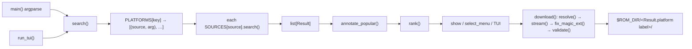

# Repository Guidelines

## Project Overview
`rom` is a CLI and Textual TUI that searches public ROM, ISO and Switch sources and downloads files with resume support. It is an English-translated fork of the Portuguese `sostenesapollo/rom-cli`, and some Portuguese strings remain. `rom-remote` runs `rom` on another machine over ssh and then rsyncs the downloaded files back, for networks that block the download hosts.

## Architecture & Data Flow
Everything lives in one file, `bin/rom`: a Python script of about 1800 lines with no `.py` extension. The parts are connected by duck typing; there are no base classes.



- **Source contract**:
  - Required: a `name` class attribute, `search(query, arg, …)`, and `resolve(result) -> (direct_url, filename)`.
  - Optional: `all_items(arg)`, which enables full-catalog browsing.
  - Sources: `RomsGames`, `RomsFun`, `RomsLab`, `ArchiveOrg`, `NoPayStation`, `DlpsGame`, and `NswGame`, which subclasses `DlpsGame` for the Switch site `nswgf.com`.
  - The removed `DlArchive` source stopped working when its API started returning 403 (`File listing is not public`). Don't bring it back.
  - Module singletons `NPS`, `DLP`, `RF` and the `SOURCES` registry sit just after `class NswGame`.
- **Switch direct paths**. Each was checked with a 16-byte `Range` GET:
  - `RomsLab.resolve` builds `filekeeper.net/download?op=download2&id=<code>&method_free=Free+download&down_direct=1`. That URL redirects (302) to a signed `edge01.fetchio.cc` link, which `stream()` follows. Resolve it right before streaming, because the signed link expires.
  - `ArchiveOrg` with arg `"switchindex"` searches `switchindex.json`. The file is built from `index_query`: software or data items, `identifier:0100*`, `-collection:loggedin`, at least 300 MB. That gives about 730 items, each read through `/metadata/<id>`; items that are restricted or have private files are skipped. Entries are `{id, name, size, title}`, plus `zip` and `path` for packages inside a zip. `_zip_members()` parses the zip listing page `/download/<id>/<zip>/`. A zip is opened only when its name has a Title ID, the item id starts with `0100-`, or the item has no loose package. Members whose name lacks a Title ID take the folder's or zip's TID (+`800` for "Update"). `_url(e)` builds `/download/<id>/<zip>/<path>` for members. `title_kind()` derives Base, Update or DLC from the Title ID suffix (`000`, `800`, other).
  - Titles: `_entry_title()` prefers the filename, then the item title. A Title-ID-only entry copies the title of a sibling with the same base TID.
  - Title-ID fallback: `switch_tid_fallback()` runs at the end of a `switch` `search()`. It acts only when no TID group matched every query word. It collects TIDs from result titles, pages and filenames; if there are none, it reads the top matching nswgame post's links (one extra request). It then calls `index_results(query, tids=…)`.
  - **Zip members download through `stream_zip_member()`**, never through their per-member URL. That URL is `view_archive.php`: a chunked, non-resumable extract that ignores Range, and Archive.org cut it off at about 1.07 GB of 13.9 GB.
    - Choices for members carry `zip_url` (the whole zip, which honours Range) and `zip_member`.
    - `RangeReader` makes the remote zip seekable for `zipfile`, which handles zip64 and checks the CRC. A dropped connection reopens at the same offset, up to 5 times.
    - The deflate state cannot resume across runs, so a new run restarts the member from byte 0 (`ponytail:`).
  - `stream(expect=)`: when the reply has no `Content-Length`, the size from the index is the floor. A shorter body raises `incomplete download` and keeps `.part`; it is never renamed into place. `validate()` skips files over 50 MiB, so this is the only truncation guard for big files.
  - `ArchiveOrg.search(…, "switch")` drops titles matching `NON_SWITCH_RE` (pc, recomp*, windows, android, port), unless the title names nsp, xci or nsz.
  - **Stale-while-revalidate**: an expired index is still served, and `_refresh_index_bg()` spawns a detached `python -c` child that runs `switch_index(force=True)`. On Windows the child is started with `DETACHED_PROCESS|CREATE_NEW_PROCESS_GROUP`; on POSIX with `start_new_session`. The marker `switchindex.json.refreshing` blocks a second spawn for 15 min. The index is built inline only when the cache is missing, its `ver` changed, or `force` is set (`--refresh`).
  - `DlpsGame`/`NswGame` auto-download from pixeldrain (`/api/file/<id>?download`), mediafire, Google Drive and 1fichier, tried in that order. MegaUp, datanodes, buzzheavier and gofile sit behind a Cloudflare page, a captcha, or a token that only their own obfuscated JS can produce. For those hosts `resolve()` raises an error that includes the links, and `--print-url` lists them.
  - RAR files are kept as downloaded and never extracted. `validate()` requires `Rar!\x1a\x07` for files of 50 MiB or less.
- **`Result`** uses `__slots__`: `source`, `title`, `platform`, `page`, `size`, `meta`.
  - `platform` holds the display **label** (`"PS Vita"`), not the key (`vita`).
  - `meta` is a free-form dict with keys such as `ext`, `kind`, `pk` (the platform key), `pop`, `bytes`, `id`, `filename` and `search_title`.
- **`search()`** queries every provider in `PLATFORMS[key]` for each query variant and stops at 12 or more hits. Within one variant the providers run **concurrently** in a `ThreadPoolExecutor`. `pool.map` keeps results in config order, so ranking is deterministic, and each job's exception is swallowed to `[]`. The variants themselves stay sequential because of the early stop. With no platform it queries romsgames and romsfun, plus NPS, dlpsgame, nswgame and romslab on the first try only. When there are fewer than 6 results it falls back to archive.org.
- **`rank()`** sorts results with a heuristic score. It boosts Wikipedia best-sellers via `meta["pop"]` and penalizes archive.org (−8), dlpsgame (−5), nswgame (−12), Update/DLC, and words in `BAD`.
- **Best-sellers** come from scraped Wikipedia lists (`WIKI_LISTS`) with a hand-written wikitext parser.
- **TUI**: Textual classes are defined *inside* `run_tui()`, and `textual` is imported there lazily. Work runs in daemon threads that update the UI via `call_from_thread`.
  - Key hints come from `Binding(..., show=True)` in the Footer. `#status` is a one-line Static docked above the Footer and is queried by id (`query_one("#status", Static)`), never by type.
  - The DataTable consumes Enter as `RowSelected`, so `on_data_table_row_selected` triggers the download. An `enter` app binding would never fire.
  - `_fill()` rebuilds the columns on every render: Type and Size appear only when some shown row has a value.
  - `_cells()` shows `↓`/`↗` from each source's `direct` class attribute. For best-seller placeholders (`source == ""`) it looks at the platform's first provider.
  - ★ means `pop_rank()` matched the title exactly and the title has no `BAD` word. The same `meta["pop"]` drives the ranking boost in `rank()`.
  - **Choices model**: a `Result` may carry `meta["choices"]`, a list of `{label, kind, url, filename, size, direct, default}`, and `meta["picked"]`, a list of indexes. `expand_choices()` turns it into one `Result` per file: the picked indexes, else the `default` ones, skipping `direct: False`. `download()` calls it and recurses, and `ArchiveOrg.resolve` uses `meta["url"]`.
  - Switch groups come from `ArchiveOrg._group_result()`, keyed by `base_tid()` (`int(tid) & ~0x1FFF`, verified against the 35 complete groups in the index). Files without a Title ID stay single rows. Defaults: the `.nsp` base and the newest update, where newest means the highest `[vN]`.
  - romsfun versions: `RomsFun.files(r)` caches the download-page rows in `meta["files"]`, `default_file()` picks USA/World non-hack, and `resolve()` honours `meta["picked"][0]`.
  - Link-only extras: `RomsLab.extras` types its post buttons by text and `DlpsGame/NswGame.extras` type their links by URL (`link_kind`). They appear in the panel as text only.
  - `merge_dupes()` (TUI only; `--list` stays one row per source) folds same `(norm(title), platform)` rows into the best-ranked one as `meta["alts"]`. A Title-ID group always joins as an alt, so its versions show up. `DetailScreen(vr=…)` lists versions from the first alt that has `choices` or romsfun `files`.
  - Queue: `_batch()` expands each row into jobs, `QueueRow` widgets are mounted in `#queue`, and one worker thread `_drain()`s the jobs in order. Each job gets a `threading.Event` passed to `download(cancel=)` and then `stream(cancel=)`. Cancel raises `"cancelled"` and keeps the `.part` file.

## Key Directories
- `bin/`: everything that ships.
  - `rom` (Python)
  - `rom-remote` (bash)

There is no package layout, `src/` directory or tests directory.

## Development Commands
```sh
./install.sh                                 # venv ~/.venvs/rom + textual; wrapper ~/bin/rom; copies rom-remote
PREFIX=/usr/local ROM_VENV=... PYTHON=python3.12 ./install.sh

python3 -m py_compile bin/rom                # syntax check
bash -n install.sh bin/rom-remote && shellcheck install.sh bin/rom-remote
python3 bin/rom --help; python3 bin/rom -l  # offline smoke
python3 bin/rom --list -p gba "pokemon"      # network, no download
python3 bin/rom --print-url -p switch "zelda"  # resolves direct links, no download
python3 bin/rom --index                     # build NPS + switch-ports + popular caches
python3 bin/rom --refresh --list -p switch "zelda"  # force-refresh caches, no download
```
Some invocations trigger real downloads:
- `-y` downloads the top result.
- Running with a query and a **non-TTY stdin** also downloads the top result automatically. This includes piped input and agent shells.

When scripting searches, always pass `--list` or `--print-url`.

## Code Conventions & Common Patterns
- **Style**:
  - 4-space indent, double quotes, dense one-liners.
  - No type hints and no docstrings, except the module docstring, which doubles as the usage text.
  - Short local names: `st, _, body = request(...)`, `r`, `pk`.
  - `snake_case` functions. A leading `_` marks private helpers (`_wiki_*`, `_mediafire`). `UPPER_CASE` for config, tables and singletons.
- **Stdlib only** for the CLI (urllib, threading, `ThreadPoolExecutor(max_workers=6)`). Import `textual`/`rich` only inside `run_tui`. Keep the module importable with no third-party packages and stay Python 3.8-compatible.
- **HTTP**:
  - All requests go through `request()` (`def request`). It retries on 429/5xx and **returns `(status, headers, body)` on HTTP errors instead of raising**, so callers must check `st`.
  - Downloads go through `stream()`, which writes `.part` files, resumes with `Range`, and finishes with an atomic `os.replace`.
  - The fake macOS Chrome `UA` is load-bearing for scraping.
- **Errors**:
  - Sources raise `RuntimeError("user-facing message")`. Callers catch `Exception`, print `✖ …`, and continue.
  - Optional sources and cache I/O deliberately swallow errors (`except Exception: pass`), so failures show up as empty results.
  - Exit codes: 0 ok; 1 nothing found or all downloads failed; 2 argparse error; 130 Ctrl-C.
- **Output**:
  - Use only `write()` and `status()`/`clear_status()`. The status line redraws in place (`\r\033[K`) only when stdout is a TTY.
  - Lines start with a two-space indent, with `✔`/`✖` marks.
  - There is no logging module and nothing is written to stderr.
  - Write new user-facing strings in English.
- **Caches** in `${XDG_CACHE_HOME:-~/.cache}/rom-cli/` all follow one pattern: an in-memory class or global cache guarded by a `threading.Lock`, plus a JSON file with `fetched_at`, written to `*.tmp` and moved into place with `os.replace`.

  | File | TTL | Notes |
  |---|---|---|
  | `nps.json` | 7d | |
  | `switchports.json` | 7d | Bump `PORTS_VER` when the entry shape changes |
  | `switchindex.json` | 7d | Archive.org Switch files (`ver` 2: entries add title/zip/path). Served stale and refreshed in the background (marker `.refreshing`, 15 min). Bump `INDEX_VER` when the entry shape changes |
  | `popular.json` | 30d | |

  `--refresh` rebuilds `nps.json`, `switchports.json`, `switchindex.json` and `popular.json`.
- **Settings** live in `${XDG_CONFIG_HOME:-~/.config}/rom-cli/config.json`, which holds only `out_dir` today.
  - Read it with `load_config()`; a missing or invalid file returns `{}`.
  - Write it with `save_config(**changes)`, which writes a `.tmp` file and then `os.replace`s it.
  - `set_out_dir()` expands `~` and `%VARS%`, creates the folder, checks it is writable, and saves it.
  - `OUT_DIR` is resolved at import with this precedence: `-o`, then `$ROM_DIR`, then config, then `~/Downloads/roms`.
  - The TUI changes the folder through `OutDirScreen` (palette → "Download folder…").
  - Modal screens that hold an `Input` must `event.stop()` in `on_input_submitted`. Otherwise `Input.Submitted` bubbles to `RomApp.on_input_submitted` and starts a search for the typed text.
- **Module-level constants used before their definition**: `PORTS_*`, `INDEX_*` and `POPULAR*` are defined after the `ArchiveOrg` code that uses them. They are read at call time, so never reference them at import time above `WIKI_LISTS`.

### Adding a platform or source
1. Add the platform to `PLATFORMS` as `key → [(source_name, arg), …]`. Providers are queried in order and their results merged. The first provider that has `all_items` drives browsing; without one, browsing falls back to Wikipedia best-sellers.
2. Add the display label to `PLATFORM_LABELS`.
3. Map provider-specific ids:
   - `RomsFun.consoles` maps the key to a WP `console` term id; live ids come from `/wp-json/wp/v2/console`.
   - `ArchiveOrg.tags` maps the key to its search terms and file extensions.
   - `LABELS` maps romsgames URL prefixes.
   - `WIKI_LISTS` maps best-seller lists.
4. For a new source class, register its instance in `SOURCES`.
   - Only `nps` gets `on_progress`/`force`.
   - Only `nps` downloads skip the Referer.
5. `switchports` has an empty provider list and is special-cased in `search()` and `browse_items()`, which use `ArchiveOrg.port_results()`.
6. Browse entries built from best-seller titles carry `meta["search_title"]`. `download()` re-runs `search()` with that title and downloads the top-ranked hit.

## Important Files
- `bin/rom`:
  - Config and tables near the top (`PLATFORMS`, `PLATFORM_LABELS`, `LABELS`, `ROM_EXTS`).
  - Sources from `class RomsGames` to `SOURCES`.
  - Then `rank`, `search`, `validate`, `download`, the best-seller code (`WIKI_LISTS`), `browse_items`, `run_tui` and `main`.
  - Find exact lines with grep `^def |^class `.
- `bin/rom-remote`:
  - Env vars: `ROM_REMOTE_HOST` (default `mac`, an ssh alias), `ROM_REMOTE_DIR`, `ROM_DIR`.
  - The remote command path is hardcoded to `~/bin/rom`.
  - `rsync --ignore-existing` never re-syncs files that have changed.
- `install.sh`:
  - The wrapper it writes **embeds the absolute path of the clone**, so repo edits take effect immediately and the clone must not be moved.
  - `rom-remote` is *copied* instead, so changes to it need a reinstall.
- `README.md`: user docs covering flags, the platform-to-source table and cache TTLs. Update it when flags, platforms or caches change.

## Runtime/Tooling Preferences
- Python 3.8+ (`#!/usr/bin/env python3`). `textual` is the only dependency; it is unpinned and needed only for the TUI. There is no pyproject or requirements file.
- **Platforms**:
  - `select_menu` reads keys with `termios`/`tty` on POSIX and `msvcrt.getwch()` on Windows. On Windows, arrow keys arrive as a `\xe0`/`\x00` prefix followed by `H` (up) or `P` (down), and `os.system("")` enables ANSI escapes in the console.
  - The wrapper written by `install.sh` is hardcoded to `#!/bin/zsh`, and its PATH hint uses fish syntax. On Windows, use the repo venv `.venv/` (gitignored) with a `rom.cmd` wrapper instead, as shown in the README.
- The Windows checkout has CRLF line endings (no `.gitattributes`) and `core.filemode=false`. Under WSL/Git Bash the shebangs fail as `python3\r`, and commits must not introduce CRLF. Set the exec bit on new scripts with `git update-index --chmod=+x`.
- Git remote: `origin` at `github.com/GDA03/rom-cli`, branch `main`. The README clone URL (`danisiber`) does not match.

## Testing & QA
- There are no tests, CI or lint config. Verify changes with `py_compile`, `bash -n`/`shellcheck` (`rom-remote` already contains shellcheck directives) and the smoke commands above.
- Pure functions can be checked with asserts: `norm`, `pretty_title`, `kind_of`, `platform_of`, `safe_name`, `rank`, `validate`, `fix_magic_ext`. Load the module without network I/O:
  ```py
  from importlib.machinery import SourceFileLoader
  rom = SourceFileLoader("rom", "bin/rom").load_module()
  ```
- Download edge cases that are easy to break:
  - `validate()` accepts files over 50 MiB without a check and rejects and deletes files under 1 KiB.
  - Resume works only if `unique_path()` yields the same name.
  - In the TUI, `-o` is not passed through `expanduser`.
  - The TUI shows at most 200 search rows and pages browse mode by 300.
