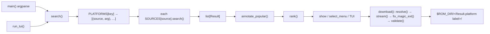

# Repository Guidelines

## Project Overview
`rom` is a CLI and Textual TUI that searches public ROM, ISO and Switch sources and downloads files with resume support. It is an English-translated fork of the Portuguese `sostenesapollo/rom-cli`, and some Portuguese strings remain. `rom-remote` runs `rom` on another machine over ssh and then rsyncs the downloaded files back, for networks that block the download hosts.

## Architecture & Data Flow
Everything lives in one file, `bin/rom`: a Python script of about 1800 lines with no `.py` extension. The parts are connected by duck typing; there are no base classes.



- **Source contract**:
  - Required: a `name` class attribute, `search(query, arg, …)`, and `resolve(result) -> (direct_url, filename)`.
  - Optional: `all_items(arg)`, which enables full-catalog browsing.
  - Sources: `RomsGames`, `RomsFun`, `ArchiveOrg`, `NoPayStation`, `DlpsGame`, and `NswGame`, which subclasses `DlpsGame` for the Switch site `nswgf.com`.
  - The removed `DlArchive` source stopped working when its API started returning 403 (`File listing is not public`). Don't bring it back.
  - Module singletons `NPS`, `DLP`, `RF` and the `SOURCES` registry sit at about `bin/rom:756`.
- **Host-link sources** (`DlpsGame`/`NswGame`) only auto-download from mediafire, Google Drive and 1fichier. Most Switch hosts (MegaUp, datanodes, buzzheavier, gofile) sit behind a Cloudflare page, a captcha, or a token that only their own obfuscated JS can produce, so `resolve()` raises an error that includes the links. `--print-url` lists them.
- **`Result`** uses `__slots__`: `source`, `title`, `platform`, `page`, `size`, `meta`.
  - `platform` holds the display **label** (`"PS Vita"`), not the key (`vita`).
  - `meta` is a free-form dict with keys such as `ext`, `kind`, `pk` (the platform key), `pop`, `bytes`, `id`, `filename` and `search_title`.
- **`search()`** queries every provider in `PLATFORMS[key]` for each query variant and stops at 12 or more hits. With no platform it queries romsgames and romsfun, plus NPS, dlpsgame and nswgame on the first try only. When there are fewer than 6 results it falls back to archive.org.
- **`rank()`** sorts results with a heuristic score. It boosts Wikipedia best-sellers via `meta["pop"]` and penalizes archive.org, dlpsgame/nswgame, Update/DLC and words in `BAD`.
- **Best-sellers** come from scraped Wikipedia lists (`WIKI_LISTS`) with a hand-written wikitext parser.
- **TUI**: Textual classes are defined *inside* `run_tui()`, and `textual` is imported there lazily. Work runs in daemon threads that update the UI via `call_from_thread`.

## Key Directories
- `bin/`: everything that ships.
  - `rom` (Python)
  - `rom-remote` (bash)

There is no package layout, `src/` directory or tests directory.

## Development Commands
```sh
./install.sh                                 # venv ~/.venvs/rom + textual; wrapper ~/bin/rom; copies rom-remote
PREFIX=/usr/local ROM_VENV=... PYTHON=python3.12 ./install.sh

python3 -m py_compile bin/rom                # syntax check
bash -n install.sh bin/rom-remote && shellcheck install.sh bin/rom-remote
python3 bin/rom --help; python3 bin/rom -l  # offline smoke
python3 bin/rom --list -p gba "pokemon"      # network, no download
python3 bin/rom --print-url -p switch "zelda"  # resolves direct links, no download
python3 bin/rom --index                     # build NPS + switch-ports + popular caches
python3 bin/rom --refresh --list -p switch "zelda"  # force-refresh caches, no download
```
Some invocations trigger real downloads:
- `-y` downloads the top result.
- Running with a query and a **non-TTY stdin** also downloads the top result automatically. This includes piped input and agent shells.

When scripting searches, always pass `--list` or `--print-url`.

## Code Conventions & Common Patterns
- **Style**:
  - 4-space indent, double quotes, dense one-liners.
  - No type hints and no docstrings, except the module docstring, which doubles as the usage text.
  - Short local names: `st, _, body = request(...)`, `r`, `pk`.
  - `snake_case` functions. A leading `_` marks private helpers (`_wiki_*`, `_mediafire`). `UPPER_CASE` for config, tables and singletons.
- **Stdlib only** for the CLI (urllib, threading, `ThreadPoolExecutor(max_workers=6)`). Import `textual`/`rich` only inside `run_tui`. Keep the module importable with no third-party packages and stay Python 3.8-compatible.
- **HTTP**:
  - All requests go through `request()` (`def request`). It retries on 429/5xx and **returns `(status, headers, body)` on HTTP errors instead of raising**, so callers must check `st`.
  - Downloads go through `stream()`, which writes `.part` files, resumes with `Range`, and finishes with an atomic `os.replace`.
  - The fake macOS Chrome `UA` is load-bearing for scraping.
- **Errors**:
  - Sources raise `RuntimeError("user-facing message")`. Callers catch `Exception`, print `✖ …`, and continue.
  - Optional sources and cache I/O deliberately swallow errors (`except Exception: pass`), so failures show up as empty results.
  - Exit codes: 0 ok; 1 nothing found or all downloads failed; 2 argparse error; 130 Ctrl-C.
- **Output**:
  - Use only `write()` and `status()`/`clear_status()`. The status line redraws in place (`\r\033[K`) only when stdout is a TTY.
  - Lines start with a two-space indent, with `✔`/`✖` marks.
  - There is no logging module and nothing is written to stderr.
  - Write new user-facing strings in English.
- **Caches** in `${XDG_CACHE_HOME:-~/.cache}/rom-cli/` all follow one pattern: an in-memory class or global cache guarded by a `threading.Lock`, plus a JSON file with `fetched_at`, written to `*.tmp` and moved into place with `os.replace`.

  | File | TTL | Notes |
  |---|---|---|
  | `nps.json` | 7d | |
  | `switchports.json` | 7d | Bump `PORTS_VER` when the entry shape changes |
  | `popular.json` | 30d | |

  `--refresh` rebuilds `nps.json`, `switchports.json` and `popular.json`.
- **Module-level constants used before their definition**: `PORTS_*` and `POPULAR*` are defined after the `ArchiveOrg` code that uses them. They are read at call time, so never reference them at import time above `WIKI_LISTS`.

### Adding a platform or source
1. Add the platform to `PLATFORMS` as `key → [(source_name, arg), …]`. Providers are queried in order and their results merged. The first provider that has `all_items` drives browsing; without one, browsing falls back to Wikipedia best-sellers.
2. Add the display label to `PLATFORM_LABELS`.
3. Map provider-specific ids:
   - `RomsFun.consoles` maps the key to a WP `console` term id; live ids come from `/wp-json/wp/v2/console`.
   - `ArchiveOrg.tags` maps the key to its search terms and file extensions.
   - `LABELS` maps romsgames URL prefixes.
   - `WIKI_LISTS` maps best-seller lists.
4. For a new source class, register its instance in `SOURCES`.
   - Only `nps` gets `on_progress`/`force`.
   - Only `nps` downloads skip the Referer.
5. `switchports` has an empty provider list and is special-cased in `search()` and `browse_items()`, which use `ArchiveOrg.port_results()`.
6. Browse entries built from best-seller titles carry `meta["search_title"]`. `download()` re-runs `search()` with that title and downloads the top-ranked hit.

## Important Files
- `bin/rom`:
  - Config and tables near the top (`PLATFORMS`, `PLATFORM_LABELS`, `LABELS`, `ROM_EXTS`).
  - Sources from `class RomsGames` to `SOURCES`.
  - Then `rank`, `search`, `validate`, `download`, the best-seller code (`WIKI_LISTS`), `browse_items`, `run_tui` and `main`.
  - Find exact lines with grep `^def |^class `.
- `bin/rom-remote`:
  - Env vars: `ROM_REMOTE_HOST` (default `mac`, an ssh alias), `ROM_REMOTE_DIR`, `ROM_DIR`.
  - The remote command path is hardcoded to `~/bin/rom`.
  - `rsync --ignore-existing` never re-syncs files that have changed.
- `install.sh`:
  - The wrapper it writes **embeds the absolute path of the clone**, so repo edits take effect immediately and the clone must not be moved.
  - `rom-remote` is *copied* instead, so changes to it need a reinstall.
- `README.md`: user docs covering flags, the platform-to-source table and cache TTLs. Update it when flags, platforms or caches change.

## Runtime/Tooling Preferences
- Python 3.8+ (`#!/usr/bin/env python3`). `textual` is the only dependency; it is unpinned and needed only for the TUI. There is no pyproject or requirements file.
- **POSIX only**:
  - `select_menu` uses `termios`/`tty`.
  - The wrapper written by `install.sh` is hardcoded to `#!/bin/zsh`.
  - The PATH hint in `install.sh` uses fish syntax.
- On this Windows checkout, run the TUI and interactive menu under WSL or on macOS/Linux. On Windows, test with `--list` or `--print-url`.
- The Windows checkout has CRLF line endings (no `.gitattributes`) and `core.filemode=false`. Under WSL/Git Bash the shebangs fail as `python3\r`, and commits must not introduce CRLF. Set the exec bit on new scripts with `git update-index --chmod=+x`.
- Git remote: `origin` at `github.com/GDA03/rom-cli`, branch `main`. The README clone URL (`danisiber`) does not match.

## Testing & QA
- There are no tests, CI or lint config. Verify changes with `py_compile`, `bash -n`/`shellcheck` (`rom-remote` already contains shellcheck directives) and the smoke commands above.
- Pure functions can be checked with asserts: `norm`, `pretty_title`, `kind_of`, `platform_of`, `safe_name`, `rank`, `validate`, `fix_magic_ext`. Load the module without network I/O:
  ```py
  from importlib.machinery import SourceFileLoader
  rom = SourceFileLoader("rom", "bin/rom").load_module()
  ```
- Download edge cases that are easy to break:
  - `validate()` accepts files over 50 MiB without a check and rejects and deletes files under 1 KiB.
  - Resume works only if `unique_path()` yields the same name.
  - In the TUI, `-o` is not passed through `expanduser`.
  - The TUI shows at most 200 search rows and pages browse mode by 300.
